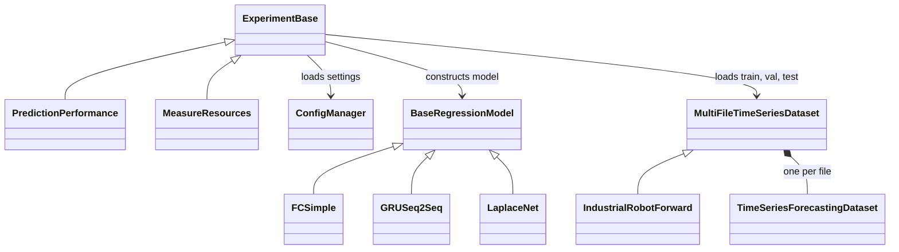

# Code structure and extensions

[Repository overview](../README.md) · [Training](../Scripts/Training/README.md) ·
[Data preparation](../Scripts/DataPreparation/README.md) · [Models](../src/models/README.md)

The scripts choose the datasets, models and seeds. Experiment classes then load
the settings, construct the data loaders and models, and run training or
measurement. Adding a dataset or model usually leaves the experiment unchanged.
For a complete run with an existing model, see the
[LaplaceNet example](../Scripts/Training/README.md#example-laplacenet-on-smd).

## Main classes



| Component | Responsibility |
| --- | --- |
| [ExperimentBase](../src/experiments/experiments_base.py) | Configuration, device and seed selection, HPO, training loops, checkpoints and result files. |
| [PredictionPerformance](../src/experiments/PredictionPerformace.py) | HPO followed by final training and prediction metrics; also training with data fractions. |
| [MeasureResources](../src/experiments/MeasureResources.py) | Timing and resource measurements. |
| [BaseRegressionModel](../src/models/models_base.py) | Shared optimizer, MSE loss, training/validation steps and prediction interface. |
| [MultiFileTimeSeriesDataset](../src/datasets/dataset_base.py) | Selects files for a split and combines their windows into one dataset; reads saved scaler information. |
| [TimeSeriesForecastingDataset](../src/datasets/dataset_base.py) | Turns one time series into history and forecast windows. The reconstruction tasks use its `TimeSeriesReconstructionDataset` subclass. |

## How the settings come together

`ConfigManager` in [experiments_base.py](../src/experiments/experiments_base.py)
builds a dictionary with three sections: `dataset`, `model` and `experiment`.
For `PredictionPerformance("SMDSystem", "LaplaceNet")`, it reads:

```text
configs/datasets/SMDSystem.yaml
configs/models/LaplaceNet.yaml
configs/experiments/PredictionPerformance.yaml
```

The names must be present in [DATASET_REGISTRY](../src/datasets/__init__.py) and
[MODEL_REGISTRY](../src/models/__init__.py). Normally each name selects a YAML
file with the same name. Existing aliases redirect a few older names to a
different file. The experiment YAML is selected by the experiment class name.

The loading order is:

1. Read the dataset YAML and add its registry name. With `scaler: "minmax"`,
   instantiate the dataset and read `scaler_params.json` from its data directory.
2. Read the model YAML. Apply its `dataset_overrides` entry for the selected
   dataset, then add the model name and saved scaler parameters.
3. If the model has `has_physics: true`, load
   `configs/models/physics/<dataset>_base.yaml`. If present,
   `<dataset>_<model>.yaml` overrides entries in that physics configuration.
4. Read the experiment YAML's `base` section and apply its dataset section.
5. Apply `configs/combination_rules.yaml` if that file exists. Then apply any
   `config_overrides` passed to the experiment constructor and choose the device.

For example, an entry under `RLCDataset` in the experiment YAML changes the
training budget for RLC, while a model's `dataset_overrides` can change its
settings for a particular dataset. The experiment's `batch_size` is used for
the data loaders.

Model parameters can specify a default and a search space:

```yaml
hidden_width:
  default: 128
  search_space:
    type: int
    low: 64
    high: 256
    step: 64
```

Before constructing a model, `get_model_defaults()` replaces these entries
with their `default` values. During HPO, sampled values override the defaults.
For final training, the selected hyperparameter dictionary overrides the
defaults instead. Parameters without a search space remain fixed.
The model constructor receives the full dictionary, including the dataset
dimensions, experiment settings and `chosen_device`.

Each run saves `config_experiment.yaml` with the assembled settings. Final
training also saves `model_config.yaml` with the resolved values used to
construct the model, including the selected hyperparameters. HPO writes
`hyperparameter_tuning/best_hyperparameters.yaml`; the main training script
also stores `best_hparams_seed_42.json` above the seed folders.
See [Training](../Scripts/Training/README.md) for the result directories.

## Adding a dataset

For prepared CSV files, copying
[IndustrialRobot.py](../src/datasets/IndustrialRobot.py) is a useful starting
point. Keep the common windowing and batching in `dataset_base.py`.

1. Rename the class and set `DATA_DIR`, `TRAIN_FILES`, `VAL_FILES` and
   `TEST_FILES`. Separate files keep windows from crossing split boundaries.
2. Adjust `load_file()` if the file format differs from CSV.
3. Set `get_channels()` to the actual column names, in the required order:

   ```python
   return {
       "time": ["time_s"],
       "excitation": ["input_1", "input_2"],
       "response": ["output_1"],
       "auxiliary": [],
   }
   ```

4. Import the class and add `"MyDataset": MyDataset` to
   [src/datasets/__init__.py](../src/datasets/__init__.py).
5. Add `configs/datasets/MyDataset.yaml`. Set `dim_x` to the number of
   excitation channels and `dim_y` to the number of response channels;
   these dimensions are not inferred automatically. Choose `history_length`,
   `forecast_length` and `stride`. A stride of `-1` uses the forecast length.
6. Select `MyDataset` in the training script's `datasets` list.

The loader reads values as prepared; it does not fit a scaler or transform
the columns during training. If scaling is used, do it during data preparation
and retain its parameters. Use `scaler: "none"` for unscaled data. Keep a time
column with the intended sampling times and document the channel units and
split/scaling choices in the preparation metadata. See the existing
[preparation scripts](../Scripts/DataPreparation/README.md) for examples.

For MinMax data, store `scaler_params.json` alongside the CSV files with channel
entries under `scaling_details`; `save_scaler_details()` in `dataset_base.py`
creates this format. Physics models such as NO-Prior need the saved extrema
to evaluate their equations in physical units. Supporting a new physical
system also requires its physics module and configuration.

The standard forecasting batch contains:

| Key | Shape |
| --- | --- |
| `excitation_history`, `response_history` | `(B, H, dim_x)`, `(B, H, dim_y)` |
| `time_history` | `(B, H, 1)` |
| `excitation_forecast`, `response_forecast` | `(B, F, dim_x)`, `(B, F, dim_y)` |
| `time_forecast` | `(B, F, 1)` |

Here `B` is the batch size, `H` the history length and `F` the forecast length.
`response_forecast` is the target; it is not passed into the model's forward
method. Optional auxiliary columns are carried separately.

## Adding a model or a variant

[FC_Simple.py](../src/models/FC_Simple.py) and
[GRU_Seq2Seq.py](../src/models/GRU_Seq2Seq.py) are compact starting points.
Use `BaseRegressionModel` and read input/output dimensions from
`config["dataset"]`, rather than fixing them for one dataset. After creating
the layers, call `self.prepare_training(config)` to set up the shared optimizer
and loss. The common interface is:

```python
def forward(self, excitation_history, response_history, time_history,
            excitation_forecast, time_forecast):
    # Return predictions with shape (B, F, dim_y).
    ...
```

The base class supplies the training and prediction loops. Override
`pretraining(data_loader)` only when the model needs a separate initialization
or pretraining stage; otherwise the inherited hook does nothing.

Import the new class in [src/models/__init__.py](../src/models/__init__.py), add
its name to `MODEL_REGISTRY`, and create `configs/models/<name>.yaml` with
fixed parameters, defaults and any HPO search spaces. Then select that name
in the training script's `algorithms` list.

For a parameter variant, reuse the existing class and give it its own registry
name and YAML file. For example, add `"FCSmall": FCSimple` to `MODEL_REGISTRY`
and copy `configs/models/FC.yaml` to `configs/models/FCSmall.yaml`. Adjust the
defaults **and** search spaces for the smaller architecture, or remove a search
space to fix that parameter. Select `FCSmall` to run it separately. No entry in
the older-name alias table is needed for a new name.

The existing `NO-Aug0` and `NO-AugH` follow this pattern: both use the same
model class, while their YAML files select zero augmentation or a history
encoder. Separate names keep their configurations and results distinct.
